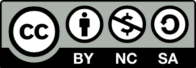

# Attributions

#### General Attributions & Licensing

Attributions and Licensing

Except where otherwise noted, this page's content is adapted from [Objective Theory of Contracts](https://rvcc.pressbooks.pub/businesslaw131interactive/chapter/5-3-objective-theory-of-contracts/) and [The Offer](https://rvcc.pressbooks.pub/businesslaw131interactive/chapter/6-2-the-offer/) in [_Business Law I - Interactive_](https://rvcc.pressbooks.pub/businesslaw131interactive/) by Melanie Morris (2024), used under [CC BY-NC-SA 4.0](https://creativecommons.org/licenses/by-nc-sa/4.0/) 

Except where otherwise noted, this page's content is adapted from [Sources and Types of Law](app://obsidian.md/Bookshelves/Civil_Law/Business_Law_I_Essentials_\(OpenStax\)/01:_American_Law_Legal_Reasoning_and_the_Legal_System/1.03:_Sources_and_Types_of_Law) in [_Business Law I Essentials_ ](https://openstax.org/details/books/business-law-i-essentials/)by Mirande Valbrune and Renee De Assis (2024), used under [CC BY-NC-SA 4.0](https://creativecommons.org/licenses/by-nc-sa/4.0/). 

Except where otherwise noted, this page's content is adapted from [What is Law and What Functions Does It Serve ](https://pressbooks.pub/introductiontobusinesslaw/chapter/chapter-1/)in [_Fundamentals of Business Law_ ](https://pressbooks.pub/introductiontobusinesslaw/)by Melissa Randall (2020), used under [CC BY 4.0](https://creativecommons.org/licenses/by/4.0). 

Except where otherwise noted, this page's content is adapted from [Page Name](https://www.example.com/) in [_Foundations of Business Law and the Legal Environment_](https://biz.libretexts.org/Bookshelves/Civil_Law/Foundations_of_Business_Law_and_the_Legal_Environment) by Don Mayer, Daniel M. Warner, George J. Siedel, Jethro K. Lieberman, and Alyssa Rose Martina, used under [CC BY-NC-SA 3.0](https://creativecommons.org/licenses/by-nc-sa/3.0/). 

Except where otherwise noted, this page's content is adapted from [1.1 Cases](https://workforce.libretexts.org/Bookshelves/Corrections/Principles_and_Procedures_of_the_Justice_System_\(Alvarez\)/01%3A_Briefing_Cases/1.1%3A_Case_Brief_Nomenclature) in [_Principles and Procedures of the Justice System_](https://workforce.libretexts.org/Bookshelves/Corrections/Principles_and_Procedures_of_the_Justice_System_\(Alvarez\)) by [Larry Alvarez](https://www.canyons.edu/directory/larry-alvarez.php), used under [CC BY 4.0](https://creativecommons.org/licenses/by/4.0). 

Except where otherwise noted, this page's content is adapted from [2.5: Chapter 6 - Probable Cause and Reasonable Suspicion](https://biz.libretexts.org/Workbench/Criminal_Procedure/05%3A_The_Fourth_Amendment/5.05%3A_Chapter_6_-_Probable_Cause_and_Reasonable_Suspicion) by [Anne M Alexander](https://law.missouri.edu/directory/anne-alexander/) and [Ben Trachtenberg](https://law.missouri.edu/directory/ben-trachtenberg/), in [_Criminal Procedure: A Free Law School Casebook 2e_](https://biz.libretexts.org/Bookshelves/Criminal_Law/Criminal_Procedure%3A_A_Free_Law_School_Casebook_2e_\(Alexander_and_Trachtenberg\)), used under [CC BY-NC-SA 4.0](https://creativecommons.org/licenses/by-nc-sa/4.0/). 

Except where otherwise noted, this page's content is adapted from [1.1 Introduction](https://workforce.libretexts.org/Workbench/Criminal_Procedure_-_Undergraduate_Edition_\(Smith\)/01%3A_Introduction) by [Christopher Smith](http://www.chrissmithjdphd.com/), [Anne M Alexander](https://law.missouri.edu/directory/anne-alexander/) and [Ben Trachtenberg](https://law.missouri.edu/directory/ben-trachtenberg/), in [_Criminal Procedure - Undergraduate Edition_](https://workforce.libretexts.org/Workbench/Criminal_Procedure_-_Undergraduate_Edition_\(Smith\)), used under [CC BY-NC-SA 4.0](https://creativecommons.org/licenses/by-nc-sa/4.0/). 

Except where otherwise noted, this page's content is adapted from [1.1 Introduction](https://2012books.lardbucket.org/books/introduction-to-criminal-law/s05-01-introduction.html) in [_Introduction to Criminal Law_](https://2012books.lardbucket.org/books/introduction-to-criminal-law/index.html) by Tara Storm, used under [CC BY-NC-SA 3.0](https://creativecommons.org/licenses/by-nc-sa/3.0/deed.en) 

Except where otherwise noted, this page is licensed under [CC BY-NC-SA 4.0](https://creativecommons.org/licenses/by-nc-sa/4.0/?ref=chooser-v1). 

The definition of _Term_ is derived or otherwise adapted from the [_Wex Legal Encyclopedia_ ](https://www.law.cornell.edu/wex)by Cornell Law School Legal Information Institute, under [CC BY-NC-SA 2.5](https://creativecommons.org/licenses/by-nc-sa/2.5/). 

#### Case Attributions

Editorial Notes, Attributions, and Licensing

This page's content is adapted from the following source(s): [2.5: Chapter 6 - Probable Cause and Reasonable Suspicion](https://biz.libretexts.org/Workbench/Criminal_Procedure/05%3A_The_Fourth_Amendment/5.05%3A_Chapter_6_-_Probable_Cause_and_Reasonable_Suspicion) by [Anne M Alexander](https://law.missouri.edu/directory/anne-alexander/) and [Ben Trachtenberg](https://law.missouri.edu/directory/ben-trachtenberg/), in [_Criminal Procedure: A Free Law School Casebook 2e_](https://biz.libretexts.org/Bookshelves/Criminal_Law/Criminal_Procedure%3A_A_Free_Law_School_Casebook_2e_\(Alexander_and_Trachtenberg\)), used under [CC BY-NC-SA 4.0](https://creativecommons.org/licenses/by-nc-sa/4.0/).  Additional modifications and annotations may have been on this page.

Many of the court's original citations to authorities and other content may have been omitted for length and readability purposes. Many elisions are not identified, particularly string citations and original footnotes when not materially necessary to the subject of the lesson. However, some elisions are identified by bracketed ellipses (e.g., \[...]).

Subject to the following, this page is licensed under [CC BY-NC-SA 4.0](https://creativecommons.org/licenses/by-nc-sa/4.0/). \
Judicial decisions and annotations thereto are not subject to copyright protection and are in the public domain. _See, e.g., Georgia v. Public.Resource.Org, Inc_., [140 S. Ct. 1498](https://scholar.google.com/scholar_case?case=8288711378870515248\&q=Georgia+et+al.+v.+Public.Resource.Org,+Inc.\&hl=en\&as_sdt=6,50) (2020).

#### Cases (My Edits) & Public Domain



#### Public Domain



#### Mine



***

#### Creative Commons

[Wiki](https://en.wikipedia.org/wiki/Creative_Commons_license)
