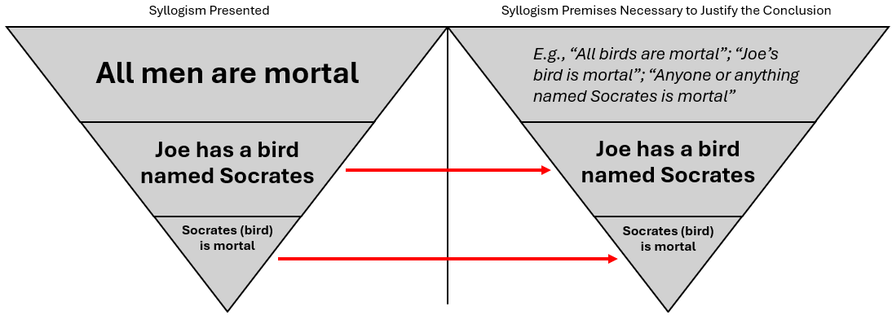

# Introduction to Deductive (Rule-Based) Reasoning

The best place to start is to appreciate that legal reasoning is fundamentally comprised of logic. Whether thinking about civil liability, criminal procedure (e.g., stop and frisk, arrest, search and seizure, etc.), or criminal laws, the courts and professionals apply specific methodologies when making decisions.

There are different legal reasoning/analysis methods, but professionals most commonly engage in both (1) [**deductive reasoning**](deductive.md#introduction) (i.e., syllogistic reasoning) and (2) [**inductive reasoning**](/broken/pages/MIoKcvv9aZ6uFAHo8bwC) (in our context, this is reasoning by analogy).

## Introduction

Most of the analysis you will perform in this class will involve deductive reasoning, which is also called [syllogistic ](#user-content-fn-1)[^1]reasoning. What we will see is that deductive reasoning produces conclusions from a set of established premises (assertions): [If A is true and B is true, then C must be true](#user-content-fn-2)[^2].

The syllogism represents a fundamental depiction of the deductive reasoning process in law, which starts with a **general assertion or proposition and ends with a specific assertion (i.e., the conclusion)**. Imagine this approach as a funnel or an [inverted pyramid](#user-content-fn-3)[^3].

<figure><figcaption>
Inverted Pyramid
</figcaption></figure>

The following sections discuss the working principles of deductive reasoning based on the syllogistic process and its relationship to legal reasoning and analysis.

## Syllogisms

### Simple Syllogisms

#### A Classic Simple Syllogism

A classic example of deductive reasoning is the "[Socrates syllogism](https://ancientspast.com/the-history-of-the-most-famous-syllogism/)":

> **Major Premise:** All [men ](#user-content-fn-4)[^4]are mortal.
>
> **Minor Premise:** Socrates is a man[^5].
>
> **Conclusion:** Socrates is mortal.

In other words, if all men are mortal, and if Socrates is a man, then Socrates is mortal. The reasoning starts with a broad premise, and the analysis applies the broad premise to the minor premise to yield the conclusion. Another way to envision this is by creating a Venn diagram:

<figure><figcaption>
Venn diagram illustrating the "Socrates syllogism"
</figcaption></figure>

In the Venn diagram, we see the two subjects contained in the **major premise**: Men are in the category of all things that are mortal. The **minor premise** places Socrates within the category of men. Because the relationships between the Venn diagram categories require the **conclusion** that Socrates is mortal.

#### Validity and Truth in Reasoning

It must be noted at the outset that in reasoning and argumentation, there is an important distinction between [valid ](#user-content-fn-6)[^6]reasoning and the truth of someone's premises. Legitimate arguments must include both valid reasoning and premises that are true. If any premise is false, then the reasoning is flawed; but if all the premises are true, the reasoning can still be invalid and render the reasoning flawed.

For reasoning to be valid, conclusions must be compatible with and relevant to the given premises. Significantly, however, whether the reasoning is valid is [_unrelated_ ](#user-content-fn-6)[^6]to whether the premises are true and accurate. To illustrate, let's revise the previous syllogism as follows:

> **Major Premise:** All men are mortal.
>
> **Minor Premise:** Joe has a bird named Socrates.
>
> **Conclusion:** Socrates, Joes bird, is mortal.

Although the premises and the conclusion may all be true, the syllogism's reasoning is invalid. The premise that Socrates is a bird is incompatible with all men being mortal. Specifically, the argument's reasoning is invalid because the minor premise that "all men are mortal" does not fit within the overarching category of Socrates being a bird. Here is how this syllogism's reasoning looks visually:

<figure><figcaption></figcaption></figure>

In this syllogism, we see how the **minor premise** about a bird and the subsequent **conclusion** about the mortality of the bird cannot follow from the **major premise** that all men are mortal. As the diagram's arrows indicate, they must be part of a different funnel. Thus, we can see the invalidity of the syllogism presented. Now, if we look at the funnel to the right, the **conclusion** that Socrates—the bird—is mortal is also invalid regardless of whether it is true. For this **conclusion** to be valid, a **major premise** is required that encompasses birds and mortality, such as "All birds are mortal"; "Joe's bird is mortal"; "Anyone or anything named Socrates is mortal"; etc.

Another illustration of this point is a Venn diagram:

<figure><figcaption>
Venn diagram illustrating the invalidity of the "Joe's bird" syllogism
</figcaption></figure>

In this Venn diagram, we see the two subjects contained in the **major premise**: Men are in the category of all things that are mortal. The **minor premise** places Socrates in the category of birds. But the syllogism's premises prevent the **conclusion** that Socrates—the bird—is mortal. Again, for that conclusion to result from valid reasoning, the syllogism should include a premise that includes the mortality of birds. (On a different note, this diagram happens to demonstrate the unstated premise that birds are mortal. The unstated premise is called an [enthymeme](deductive.md#enthymemes). Reasoning that uses enthymemes is discussed in detail [below](deductive.md#enthymemes).)

#### Beware of Other Logical Errors in Deductive Reasoning

Another problem impacting validity may be less conspicuous than the preceding syllogisms. For example:

> **Major Premise:** Some writers make syllogistic arguments.
>
> **Minor Premise:** Matt is a writer.
>
> **Conclusion:** Therefore, Matt made a syllogistic argument.

The conclusion is based on a logical error because the syllogism lacks facts to determine whether Matt falls within the class of "some" writers who make syllogistic arguments. All of the evidence we have about Matt is that he is a writer, but this means only that Matt might be a writer who either (1) made a syllogistic argument or (2) did not make a syllogistic argument. There is no evidence from the premises to conclude on way or another. In a Venn diagram, for example, there would be two groups related to writers: Writers who do make syllogistic arguments and those who do not. But even though Matt is a writer, there is there no way to tell which is Matt's group. Thus, the conclusion is invalid.

Some logical flaws can be more subtle. Take the following syllogism, [for example](#user-content-fn-7)[^7]:

> **Major Premise:** All superheroes have at least one ability that is superhuman (i.e., more exceptional or extraordinary than homo sapiens are considered capable of).\*
>
> **Minor Premise:** Superman can travel faster than the speed of light.
>
> **Conclusion:** Superman is a superhero.

Unlike the "some writers" example above, this major premise applies to an entire class. However, like the "some writers" example, even if each part of the syllogism is true does not mean that the the logic is valid; _this "superhero" syllogism is flawed_. Stating that all superheroes have a superhuman ability _does not_ mean that superheroes are the only beings with superhuman abilities. So, the premises in this argument lack the facts necessary to logically conclude that Superman is a superhero.

### Polysyllogisms

Because real-life circumstances can be complex, deductive reasoning _frequently_ requires applying more premises than exist with simple syllogisms. These circumstances require a **polysyllogism**—a syllogism with [more than two premises—to include a more complex analysis to support a conclusion](#user-content-fn-8)[^8].

#### A "Socrates" Polysyllogism

Here is an [example ](#user-content-fn-8)[^8]of a polysyllogism based on the Socrates syllogism, and the issue is whether Socrates is a god:

> **Major Premise 1:** Anyone or anything that is mortal is subject to death.
>
> **Major Premise 2:** All humans are mortal.
>
> **Major Premise 3:** Those who are mortals are not gods.
>
> **Minor Premise:** Socrates is a human.
>
> **Analysis Leading to the Conclusion:**
>
> * Because mortals can die, and all humans are mortal, humans can die.
> * Because because those can can die are not gods, humans are not gods.
> * Because Socrates is a human, Socrates can die.
> * Because Socrates can die, Socrates is not a god.

In this example, we see how the analysis supporting the argument that Socrates is a god requires the application of multiple premises to one another. Each step of the analysis was explict and did not include any implicit presumptions (i.e., propositions presumed to be true and not explicitly stated by the arguer). However, people frequently make arguments using enthymemes. Enthymemes _can_ be legitimate, but depending on the reasoning, they can also allow for fallacious and otherwise flawed arguments.

## Enthymemes

In their arguments, many people use [**enthymemes**](#user-content-fn-9)[^9]**,** which are implicit premises. Generally, arguers will use enthymemes for efficiency when they presume that the omitted premise is obvious[^10].

In daily conversations, policitcal arguments, legal reasoning (including [judicial opinions](#user-content-fn-10)[^10]), etc., enthymemes are common. For example[^11]:

> * Drunk driving hurts innocent people.
> * Therefore, drunk driving is wrong.

This argument contains an implicit premise: Hurting innocent people is wron&#x67;_._ In other words, the argument presumes that hurting innocent people is wrong.

But enthymemes must be treated [with caution](#user-content-fn-12)[^12] because some people may use them unintentionally or intentionally as [hasty generalizations](#user-content-fn-13)[^13], or sometimes, to mislead someone that a false premise is actually true. Hasty generalizations and false premises can lead to fundamentally flawed conclusions. For example[^11]:

> * Governor Johnson wants to reduce government regulation and oversight.
> * Therefore, Governor Johnson is an anarchist.

Here, the presumption is that a person who wants to reduce government regulation and oversight is an anarchist. Certainly, this presumption cannot be universally true. Thus, the result—Governor Johnson is an anarchist _because_ he wants to reduce regulation and oversight—is fundamentally flawed because of a hasty generalization (one of many [**fallacies** ](#user-content-fn-14)[^14]that people make in arguments).

Since this is a class about the law, we next explore how deductive reasoning applies in the legal context.

## Deductive Reasoning in the Legal Context

In law, the sets of propositions include both:

1. **Rules of law**, which are also known as "legal rules," "laws of the case," "rules of the case," or simply "rules."
2. **Facts** of the case.


* In the law, there are typically two categories of **rules**: (1) **codified** and (2) **case law** (i.e., rules issued by courts in judicial decisions).
  * Codified rules include the text of laws such as constitutions, statutes, administrative regulations, and government agency and departmental policies (e.g., standard operating procedures).
  * Case law is a type of law written by courts to both interpret codified laws and establish or extend the case law (i.e., [common law](https://www.law.cornell.edu/wex/common_law), which we refer to generally as "cases" "opinions," and "decisions." For instance, the U.S. Supreme Court establishes interpretations of constitutional text (through principles of reasonable suspicion and probable cause, stop and frisk, search and seizure, interrogations, etc.), and regularly extends those principles as further applications of those principles become necessary (e.g., exceptions to the warrant requirement, cell phone searches, blood draws, etc.).
* "**Facts**" refers to a given set of circumstances, such as the situation an officer finds themselves in (e.g., witnessing suspected criminal activity, establishing probable cause to apply for a search warrant, when or how much force to use, the behavior of a suspect or inmate).


In the legal context, if using the rule-based reasoning methodology, the Socrates syllogism would look like this:

> **Rule (the major premise):** All men are mortal.
>
> **Facts (the minor premise) :** Socrates is a man.
>
> **Analysis leading to the conclusion—which, in law, is referred to as the application of the rule to the facts:** Because (1) all men are mortal and (2) Socrates is a man, Socrates must be mortal.

### The Legal Simple Syllogism

Moving into the legal context in its plainest form, a legal syllogism in criminal cases [looks like this](#user-content-fn-15)[^15]:

> **Rule (the "formula"):** \[**Doing something**] violates \[**a law**.]
>
> **Fact (the "variable"):** The defendant \[**did something**].
>
> **Analysis to Conclusion:** The defendant violated \[**the law**].

Here is a [legal example](#user-content-fn-16)[^16]:

> **Rule (the "formula"):** Section 999.01 of the East Dakota statutes states, "Whosoever, while legally married, shall go through another marriage ceremony recognized by law, shall be guilty of bigamy.
>
> **Facts (the "variables"):** Allen, while married, went through another marriage ceremony recognized by law.
>
> **Analysis to Conclusion:** Because bigamy going through another marriage ceremony recognized by law while already legally married, having multiple legal marriages makes Allen guilty of bigamy.

Here is a second example:

> **Rule (the "formula"):** A law enforcement officer must give a suspect _Miranda_ warnings before asking questions intended to elicit an incriminating response when the suspect is in custody.
>
> **Facts (the "variables"):** Lucy, a law enforcement officer, arrested Charlie, secured him a patrol car, and drove him to the police station.
>
> **Analysis:** Although Charlie was in custody, the facts do not indicate that Lucy asked Charlie any questions intended to elicit an incriminating response.
>
> **Conclusion:** Therefore, under the circumstances, Lucy was not yet required to give Charlie _Miranda_ warnings.

### A Legal Polysyllogism

Here is a [legal example](#user-content-fn-17)[^17] of a polysyllogism:

> **Rule 1 (a "formula"):** Section 940.01 of the East Dakota statutes states, "Whoever is guilty of murder if they intentionally cause the death of another human being without a legal justification.
>
> **Rule 2 (a "formula"):** For murder, "intentional" means that the person acted with the purpose to cause the result.
>
> **Rule 3 (a "formula"):** The legal justification for murder is self-defense.
>
> **Fact 1 (a "variable"):** Henry is a human being.
>
> **Fact 2 (a "variable"):** Evidence[^18] from the investigation demonstrated that Jospeh shot and killed Henry inside Henry's home.
>
> **Fact 3 (a "variable"):** [Evidence ](#user-content-fn-18)[^18]from the investigation demonstrated that before killing Henry, Joseph broke into Henry's home, waited for Henry to return.
>
> **Fact 4 (a "variable"):** [Evidence ](#user-content-fn-18)[^18]from the investigation demonstrated Joseph did not act in self-defense at the time he killed Henry.
>
> **Analysis:**
>
> * Joseph's act of shooting Henry, a human being, caused the death of another human being.
> * That Joseph laid in wait for Henry to return home is evidence that Joseph had the purpose to cause Henry's death.
> * Because Joseph had the purpose to cause Henry's death, he caused Henry's death intentionally.
> * Because Joseph did not act in self-defense when causing Henry's death, Joseph had no legal justification.
> * Therefore, Joseph is guilty of murder.

### Syllogisms (and Polysyllogisms) in Case Law

Common to judicial opinions, some arguments require a little extra work to find the syllogism.\* For example, based on the question of whether there is a constitutional right to an abortion, in [_Roe v. Wade_](#user-content-fn-19)[^19], the majority wrote:

> \[The] right of privacy, whether it be founded in the Fourteenth Amendment’s concept of personal liberty and restrictions upon state action, as we feel it is, or, as the District Court determined, in the Ninth Amendment’s reservation of rights to the people, is broad enough to encompass a woman’s decision whether or not to terminate her pregnancy.

It may take some effort to extract the syllogism from this text because some premises are implicit, but this is the Court's argument:

> **Rule:** The Fourteenth Amendment provides for personal liberty and restrictions on state actions against a citizen, and the Ninth Amendment reserves rights \[not specifically enumerated in the first eight amendments] to the people.
>
> **Rule:** Either the Fourteenth \[as the Court's majority contends] or the Ninth Amendment, a right of privacy exists.
>
> **Rule:** If a state law criminalized someone for exercising their right of privacy, the law would be unconstitutional.
>
> **Rule:** The right of privacy includes a woman's decision whether to or not to terminate her pregnancy.
>
> **\[Facts from&#x20;**_**Roe v. Wade**_**&#x20;not described above:** In Texas, it was a crime to "procure an abortion." Roe was unable to find a doctor willing to perform an abortion (because the doctors did not want to be convicted of a crime). Roe claimed that the law banning abortion was unconstitutional.**]**
>
> **Analysis:**
>
> * By wishing to terminate her pregnancy, Roe was attempting to exercise her right of privacy.
> * The Texas law criminalized her attempt to exercise her right of privacy.
> * By criminalizing Roe's exercise of her right to privacy, the Texas law violated the Fourteenth and/or the Ninth Amendment.
>
> **Conclusion:** The Texas law was unconstitutional.

Now that we have taken a look at deductive or rule-based reasoning, we will move on to a type of inductive reasoning: [**analogical reasoning**](/broken/pages/MIoKcvv9aZ6uFAHo8bwC).

***



[^1]: See [Syllogisms](deductive.md#syllogisms); [Kulicki (2020)](/broken/pages/dV3xLCLuJyIuIcQAKHDQ).

[^2]: [Aldisert et al.](/broken/pages/dV3xLCLuJyIuIcQAKHDQ), 3.

[^3]: [Swisher](/broken/pages/dV3xLCLuJyIuIcQAKHDQ), 537, 539 n.18.

[^4]: i.e., humans

[^5]: i.e., human

[^6]: [Fields](/broken/pages/dV3xLCLuJyIuIcQAKHDQ) (2024).

[^7]: This example is adapted from [Aldisert et al.](/broken/pages/dV3xLCLuJyIuIcQAKHDQ), 10.

[^8]: [Aldisert et al.](/broken/pages/dV3xLCLuJyIuIcQAKHDQ), 9.

[^9]: [Aldisert et al.](/broken/pages/dV3xLCLuJyIuIcQAKHDQ), 8; [Nordquist](/broken/pages/dV3xLCLuJyIuIcQAKHDQ).

[^10]: Ruggero J. Aldisert, Stephen Clowney, & Jeremy D. Peterson, _Logic for Law Students: How to Think Like a Lawyer_. [69 U. PITT. L. REV. 1](https://doi.org/10.5195/lawreview.2007.117), 8 (2007).

[^11]: Literary Terms, [_Enthymeme_](https://literaryterms.net/enthymeme/) (last visited June 20, 2024).

[^12]: [Aldisert et al.](/broken/pages/dV3xLCLuJyIuIcQAKHDQ), 8.

[^13]: [Ramee ](/broken/pages/dV3xLCLuJyIuIcQAKHDQ)(2002); [Nordquist ](/broken/pages/dV3xLCLuJyIuIcQAKHDQ)(2019).

[^14]: See generallly, [Ramee](/broken/pages/dV3xLCLuJyIuIcQAKHDQ).

[^15]: See [Aldisert et al.](/broken/pages/dV3xLCLuJyIuIcQAKHDQ), 6.

[^16]: This example is adapted from [Swisher](/broken/pages/dV3xLCLuJyIuIcQAKHDQ), 536.

[^17]: [Swisher](/broken/pages/dV3xLCLuJyIuIcQAKHDQ), 536.

[^18]: For the purposes of this exercise, investigators or the prosecution would have already performed other reasoning to draw this conclusion from the evidence.

[^19]: The fact that [_Roe v. Wade_](https://scholar.google.com/scholar_case?case=12334123945835207673\&q=roe+v.+wade\&hl=en\&as_sdt=6,50) was overturned by [_Dobbs v. Jackson Women's Health Organization_](https://scholar.google.com/scholar_case?case=10996775398954026979\&hl=en\&as_sdt=6,50) in 2022 does not affect the purpose and legitimacy of this example.
